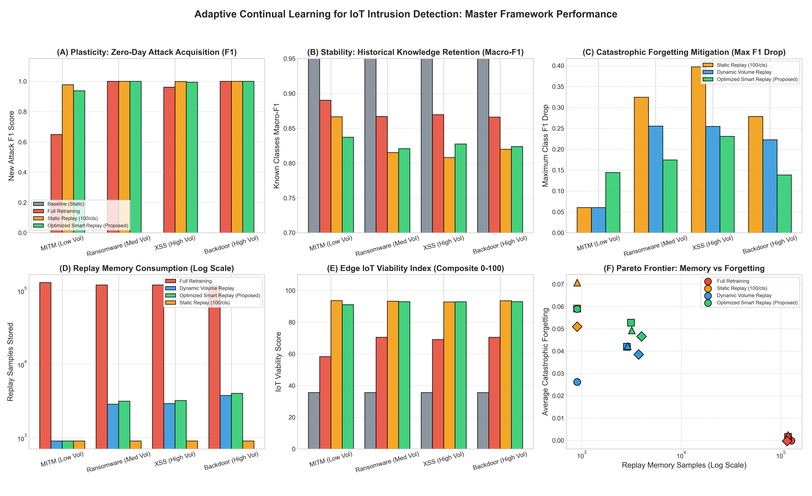
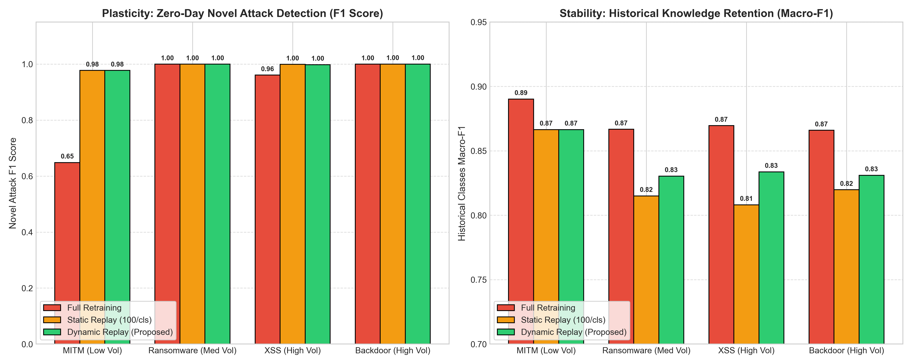
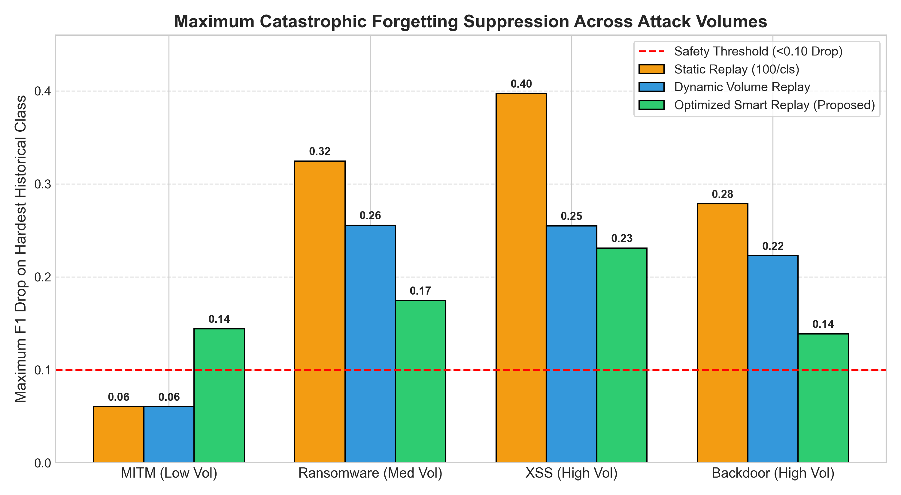
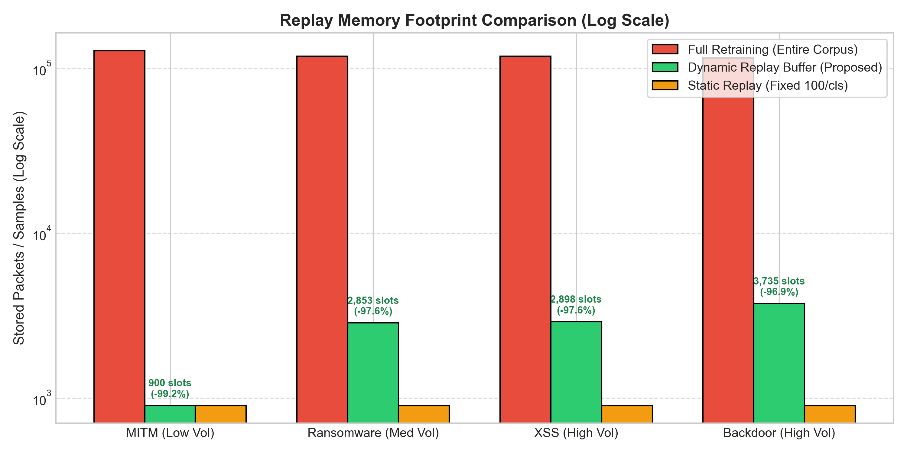

# Adaptive and Resource-Efficient Network Intrusion Detection for Previously Unseen Attacks in IoT Networks

[](https://www.python.org/)
[](LICENSE)
[](IEEE_Paper.tex)
[](https://research.unsw.edu.au/projects/toniot-datasets)
[](#sustainability--un-sdg-alignment)
[](https://chitchula-sai-bhuvan.github.io/Adaptive-Resource-Efficient-Network-Intrusion-Detection-for-Previously-Unseen-Attacks-IoT-Networks/)

---

## 📌 Executive Summary

Contemporary Machine Learning-based Network Intrusion Detection Systems (NIDS) deployed on edge Internet of Things (IoT) gateways achieve near-perfect classification accuracy ($>97\%$) on static benchmarks. However, they rely on a **Closed-World Assumption** that renders them completely blind to previously unobserved zero-day attack vectors ($0.0000$ detection recall). 

When edge gateways are retrained to assimilate emergent threats, they face an acute operational trilemma:
1. **Flash Storage & Latency Exhaustion:** Storing raw historical packet archives ($\sim$128,000 flows) exhausts memory and causes prohibitive retraining delays.
2. **Catastrophic Forgetting:** Incremental updates overwrite historical decision boundaries, causing up to **$39.7\%$** degradation on earlier threat classes.
3. **The Gini Impurity Dilution Trap:** In decision tree induction, massive historical archives drown out compact zero-day attacks (e.g., $M \approx 200$ flows), yielding poor new-attack recall (only $0.6483$ F1 on MITM).

This repository contains the complete, reproducible implementation of our **Two-Stage Continual Intrusion Detection Architecture** and volume-aware **Dynamic Replay Buffer Allocation Rule**, engineered specifically for resource-constrained edge IoT devices ($<1$\,MB RAM, sub-$0.085$\,second adaptation).

---

## 🔬 Key Scientific & Technical Contributions

- **Proof of Closed-World Blindness:** Closed-world Random Forest baselines score an exact **0.0000 F1-score** on unseen attacks, misrouting up to $29.26\%$ of attacks into benign `normal` traffic.
- **Unsupervised Anomaly Screening as Adaptation Trigger:** An unsupervised Isolation Forest flags $18.86\%$ of unseen MITM attacks vs. only $2.70\%$ of known traffic, providing a **$7\times$ anomaly concentration factor** to trigger supervised adaptation.
- **Solving the Gini Impurity Dilution Trap:** Proves mathematically why full joint retraining fails on rare attacks. Class-balanced replay ($k=100$/class) equalizes split priors, raising novel MITM F1 from **0.6483** (full retraining) to **0.9773** ($+32.9\%$ improvement) while saving **99.30%** memory and accelerating training by **$11.6\times$**.
- **Volume-Aware Dynamic Replay Rule:** Eliminates static buffer fragility during volumetric attack floods (Ransomware, XSS, Backdoor), cutting maximum catastrophic forgetting by **20.0% to 35.9%** while preserving $>96.7\%$ memory savings.
- **Real-Time Edge Realizability:** Adaptation completes in **under 0.085 seconds** on commodity quad-core ARM gateway hardware.

---

## 🏗️ System Architecture

The framework operates across two decoupled, line-rate and on-demand stages comprising seven operational modules (M1--M7):

```
                        Incoming Bidirectional Network Flow x_t
                                          │
                                          ▼
                      ┌───────────────────────────────────────┐
                      │    M1: Flow Preprocessing & Hygiene   │
                      │   (IP/Port Stripping, Deduplication)  │
                      └───────────────────┬───────────────────┘
                                          │
                 ┌────────────────────────┴────────────────────────┐
                 ▼                                                 ▼
   ┌───────────────────────────┐                     ┌───────────────────────────┐
   │  M2: Supervised RF Model  │                     │ M3: Unsupervised IF Screen│
   │  (Line-rate 100 Trees)    │                     │ (Anomaly Score s(x, n))   │
   └─────────────┬─────────────┘                     └─────────────┬─────────────┘
                 │ (Known Class Output)                            │ (Anomaly Alert Spike)
                 ▼                                                 ▼
        [Active Fast Path]                           ┌───────────────────────────┐
     Multi-class Threat Alert                        │  M4: Analyst Verification │
                                                     │  (Confirmed Batch D_new)  │
                                                     └─────────────┬─────────────┘
                                                                   │
                                                                   ▼
                                                     ┌───────────────────────────┐
                                                     │ M5: Dynamic Replay Buffer │
                                                     │ k_dyn = min(k_max,        │
                                                     │   max(k_min, floor(M/K))) │
                                                     └─────────────┬─────────────┘
                                                                   │
                                                                   ▼
                                                     ┌───────────────────────────┐
                                                     │   M6: Adaptation Engine   │
                                                     │ Retrains on B U D_new     │
                                                     │ in sub-0.085s on Edge CPU │
                                                     └─────────────┬─────────────┘
                                                                   │
                                                                   ▼
                                                     [Atomic Model Deployment]
```

### The Dynamic Replay Allocation Rule
To mathematically neutralize the **Volumetric Imbalance Ratio** $\rho = \frac{M}{K \cdot k} \approx 1.0$:
$$k_{\text{dyn}} = \min\!\left( k_{\max},\; \max\!\left( k_{\min},\; \left\lfloor \frac{M \cdot \alpha}{K} \right\rfloor \right) \right)$$
- **$k_{\min} = 100$:** Guaranteed historical exemplar floor (Pareto knee preventing class starvation).
- **$k_{\max} = 555$:** Hardware-enforced ceiling capping buffer below $5{,}000$ flows ($<1$\,MB RAM).
- **$\alpha = 1.0$:** Equilibrium class balancing multiplier.

---

## 📁 Repository Directory Structure

```text
├── IEEE_Paper.tex                # Standard IEEE Conference publication manuscript
├── LICENSE                       # MIT Open-Source License
├── README.md                     # Comprehensive technical documentation
├── requirements.txt              # Pinned Python dependencies
├── configs/                      # Experiment hyperparameter configurations
├── data/                         # Benchmark partitions & preprocessed samples
├── docs/                         # Live Documentation Portal (GitHub Pages)
│   ├── index.html                # Interactive single-page web application
│   └── images/                   # Publication-quality vector & PNG figures
├── models/                       # Checkpoints & serialized model artifacts
├── notebooks/                    # Interactive Jupyter exploration notebooks
├── results/                      # Empirical logs, metrics, tables, and LaTeX
│   ├── figures/                  # 300-DPI publication figures
│   │   ├── master/               # Master comparative dashboards
│   │   └── publication/          # Radar, bar, and Pareto tradeoff charts
│   ├── tables/                   # Generated evaluation CSV tables
│   └── thesis_latex/             # Complete M.Tech thesis LaTeX sources
└── src/                          # Production source code
    ├── continual/                # Continual learning algorithms
    │   ├── buffer_manager.py     # Exemplar sampling & memory buffer management
    │   └── dynamic_replay.py     # Volume-aware Dynamic Replay allocation logic
    ├── evaluation/               # Continual learning evaluation suite
    │   └── continual_metrics.py  # Plasticity, Stability, F_avg, F_max, BWT, PSI, EIVI
    ├── models/                   # Classifier implementations
    │   └── random_forest.py      # Base supervised ensemble
    ├── preprocessing.py          # Leakage-free feature pipeline & deduplication
    └── visualization/            # 300-DPI publication plot generators
```

---

## ⚡ Quickstart & Installation

### 1. Clone the Repository
```bash
git clone https://github.com/Chitchula-Sai-Bhuvan/Adaptive-Resource-Efficient-Network-Intrusion-Detection-for-Previously-Unseen-Attacks-IoT-Networks.git
cd Adaptive-Resource-Efficient-Network-Intrusion-Detection-for-Previously-Unseen-Attacks-IoT-Networks
```

### 2. Environment Setup
```bash
# Create and activate a clean virtual environment
python3 -m venv .venv
source .venv/bin/activate  # On Windows: .venv\Scripts\activate

# Install dependencies
pip install --upgrade pip
pip install -r requirements.txt
```

### 3. Run Pipeline Preprocessing
```bash
python3 src/preprocessing.py
```

### 4. Execute Continual Learning Leave-One-Attack-Out Benchmarks
```bash
# Run Dynamic Replay across all four zero-day scenarios (MITM, Ransomware, XSS, Backdoor)
python3 src/continual/dynamic_replay.py --run-all
```

### 5. Generate Publication Figures
```bash
python3 src/visualization/generate_publication_figures.py
```

---

## 📊 Empirical Evaluation & Key Results

Evaluated on the **TON_IoT** benchmark corpus ($183{,}592$ clean, deduplicated flows across $41$ attributes):

### 1. Strategy Benchmark on Stealthy Low-Volume Zero-Day (MITM, $M = 207$)
| Strategy | Memory Footprint | Storage Saved | New Attack F1 | Known Macro-F1 | Mean Forgetting ($\mathcal{F}_{\text{avg}}$) | Retrain Time |
| :--- | :---: | :---: | :---: | :---: | :---: | :---: |
| **No Update (Baseline)** | 127,787 pkts | 0.0% | **0.0000** | 0.9890 | 0.0000 | -- |
| **Full Retraining (Joint)** | 127,787 pkts | 0.0% | **0.6483** | 0.9891 | -0.0002 | 0.7355 s |
| **Static Replay ($k=25$)** | 225 pkts | 99.82% | **0.9804** | 0.9256 | 0.0634 | 0.0512 s |
| **Static Replay ($k=50$)** | 450 pkts | 99.65% | **0.9798** | 0.9476 | 0.0414 | 0.0604 s |
| **Static Replay ($k=100$)** | 900 pkts | 99.30% | **0.9773** | 0.9628 | 0.0262 | 0.0607 s |
| **Dynamic Replay (Proposed)** | **900 pkts** | **99.30%** | **0.9773** | **0.9628** | **0.0262** | **0.0607 s** |

*Key Takeaway:* Full joint retraining drowns out rare zero-day threats ($0.16\%$ presence in training split), yielding an unacceptable **$0.6483$ F1**. Class-balanced Dynamic Replay achieves **$0.9773$ F1 (+32.9% gain)** while updating $11.6\times$ faster.

---

### 2. Volumetric Attack Forgetting Mitigation
When high-volume attacks arrive ($M > 2{,}800$), static buffers experience an imbalance surge ($\rho > 3.0$), causing catastrophic forgetting to spike on historical classes. Dynamic Replay scales memory proportionally to suppress forgetting:

| Attack Scenario | Strategy | Replay Quota ($k$) | Retained Flows | New Attack F1 | Known F1 | Worst Forgetting ($\mathcal{F}_{\max}$) | $\mathcal{F}_{\max}$ Cut |
| :--- | :--- | :---: | :---: | :---: | :---: | :---: | :---: |
| **Ransomware** ($M=2{,}853$) | Static Replay | 100 | 900 | 0.9997 | 0.9056 | 0.3245 | Baseline |
| | **Dynamic Replay** | **317** | **2,853** | **0.9997** | **0.9227** | **0.2555** | **-21.3%** |
| **XSS** ($M=2{,}903$) | Static Replay | 100 | 900 | 0.9988 | 0.8979 | 0.3972 | Baseline |
| | **Dynamic Replay** | **322** | **2,898** | **0.9978** | **0.9263** | **0.2548** | **-35.9%** |
| **Backdoor** ($M=3{,}742$) | Static Replay | 100 | 900 | 0.9999 | 0.9109 | 0.2785 | Baseline |
| | **Dynamic Replay** | **415** | **3,735** | **0.9999** | **0.9234** | **0.2228** | **-20.0%** |

---

## 🖼️ Publication Figure Gallery

| Master Executive Dashboard | Plasticity vs. Stability Dilemma |
| :---: | :---: |
|  |  |

| Volumetric Catastrophic Forgetting Suppression | Replay Memory Footprint & Efficiency |
| :---: | :---: |
|  |  |

---

## 🌿 Sustainability & UN SDG Alignment

This research establishes a practical **Green AI** paradigm by balancing state-of-the-art cyber defense with computational energy efficiency:
- **SDG 9 (Industry, Innovation, and Infrastructure):** Hardens edge industrial IoT gateways and critical infrastructure against emergent zero-day threats without relying on high-bandwidth cloud offloading.
- **SDG 11 (Sustainable Cities and Communities):** Shields smart city sensor deployments (traffic systems, environmental sensors, municipal grids) from automated botnet disruption.
- **SDG 12 (Responsible Consumption and Production):** Eliminates repetitive full retraining cycles and compresses historical storage by **$>96.7\%$**, slashing energy consumption and thermal dissipation on battery-powered edge hardware.

---

## 📖 Citation

If you use this codebase, methodology, or benchmark in your research, please cite our IEEE conference paper:

```bibtex
@inproceedings{bhuvan2026adaptivenids,
  title={{Adaptive and Resource-Efficient Network Intrusion Detection for Previously Unseen Attacks in IoT Networks}},
  author={Chitchula Sai Bhuvan and Panduranga Ravi Teja},
  booktitle={IEEE Conference on Communications and Network Security / IoT},
  pages={1--6},
  year={2026},
  organization={IEEE}
}
```

---

## 👨‍💻 Authors & Academic Affiliation

- **Student Author:** Chitchula Sai Bhuvan (`cb.sc.p2cse25007@cb.students.amrita.edu`)
- **Faculty Guide:** Dr. Panduranga Ravi Teja (`p_raviteja@cb.amrita.edu`)
- **Department:** Department of Computer Science and Engineering  
- **School:** Amrita School of Computing  
- **Institution:** Amrita Vishwa Vidyapeetham, Coimbatore, India

---

## 📄 License
This project is licensed under the [MIT License](LICENSE) - see the LICENSE file for details.
